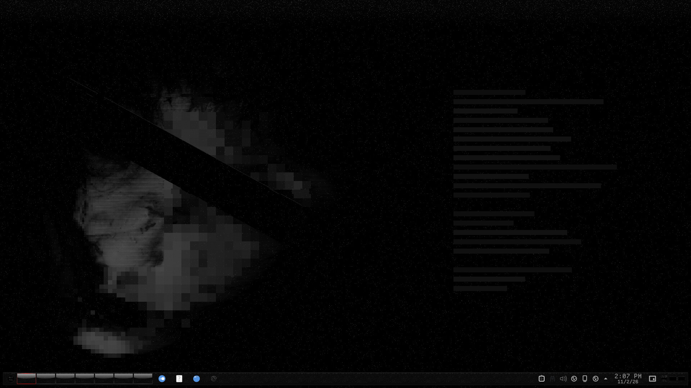

# Redacted — Wallpaper (still)

The still Redacted wallpaper: a grey face behind a censor bar on black, in 1920×1080, 2560×1440 and 3840×2160.



Redacted is a monochrome-black look for KDE Plasma 6 about obfuscation and censorship. Every colour is a neutral grey, and the accents sit only a few levels above black: almost imperceptible, but just perceptible. The motifs are static, mosaic pixelation, black censor bars and a dissociated double.

## Features

- A grey face behind a censor bar and a scatter of mosaic, on black.
- Three sizes: 1920×1080, 2560×1440 and 3840×2160.
- Uses no GPU at all. This is the still counterpart to the animated **redacted-wallpaper**.


## Requirements

Any Plasma version.

## Install

```bash
git clone https://github.com/numbpill3d/redacted-image-wallpaper
cd redacted-image-wallpaper && ./install.sh
```

Or from the KDE Store: Extract it to `~/.local/share/wallpapers/`, then pick **Redacted** under Desktop and Wallpaper.

## The rest of the suite

| piece | repo |
|---|---|
| Global theme + splash screen | [redacted-global](https://github.com/numbpill3d/redacted-global) |
| Plasma style (panel, popups) | [redacted-plasma](https://github.com/numbpill3d/redacted-plasma) |
| Aurorae window decoration | [redacted-aurorae](https://github.com/numbpill3d/redacted-aurorae) |
| Colour scheme | [redacted-colors](https://github.com/numbpill3d/redacted-colors) |
| Kvantum widget style | [redacted-kvantum](https://github.com/numbpill3d/redacted-kvantum) |
| Icon theme | [redacted-icons](https://github.com/numbpill3d/redacted-icons) |
| Konsole + kitty colours | [redacted-konsole](https://github.com/numbpill3d/redacted-konsole) |
| SDDM login | [redacted-sddm](https://github.com/numbpill3d/redacted-sddm) |
| Plymouth boot splash | [redacted-plymouth](https://github.com/numbpill3d/redacted-plymouth) |
| Animated wallpaper (desktop + lock) | [redacted-wallpaper](https://github.com/numbpill3d/redacted-wallpaper) |
| KWin open/close effect | [redacted-censor](https://github.com/numbpill3d/redacted-censor) |
| KWin script: active window under review | [redacted-static](https://github.com/numbpill3d/redacted-static) |
| Clock plasmoid | [redacted-clock](https://github.com/numbpill3d/redacted-clock) |

Everything at once, with the generators: [redacted-kde](https://github.com/numbpill3d/redacted-kde).

## Tags

`redacted` `kde` `plasma6` `dark` `black` `monochrome` `grayscale` `minimal` `censored` `glitch` `static` `pixel` `wallpaper` `4k` `black-wallpaper` `face` `dark-wallpaper`

## Credits and licence

By splicer scorn (voidrane). GPL-3.0-or-later.
The face is the author's own artwork.
